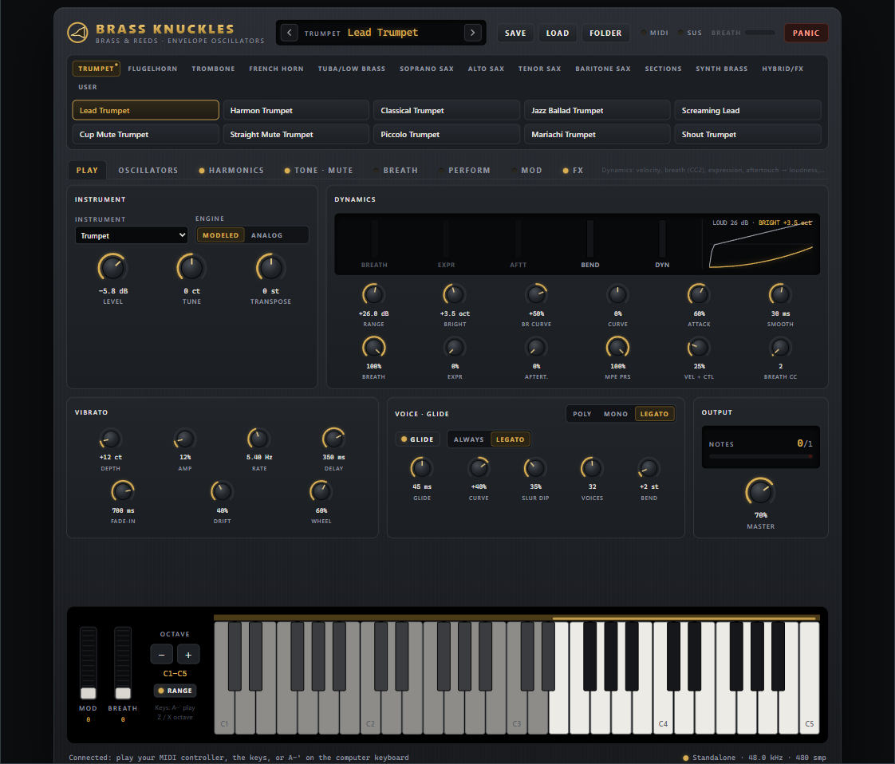
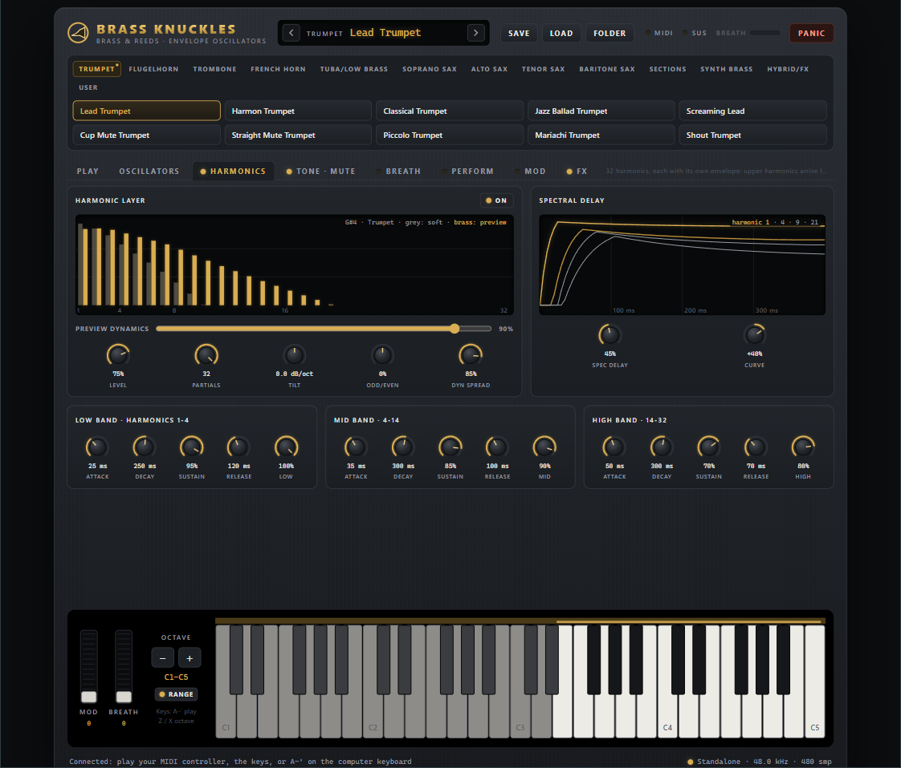
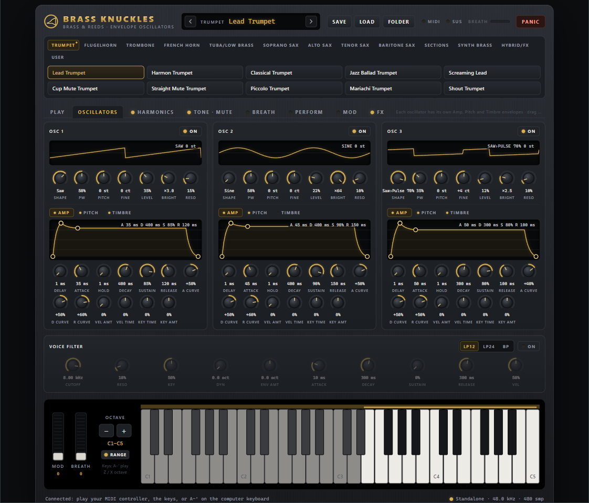
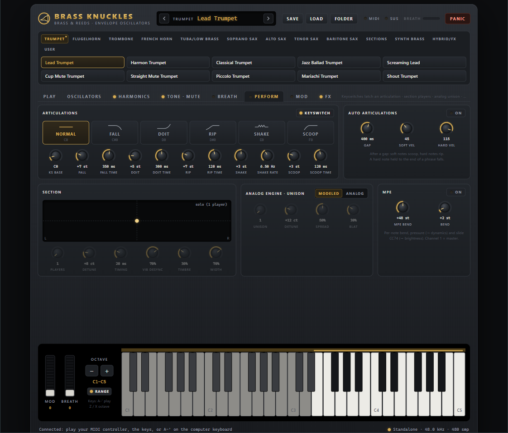
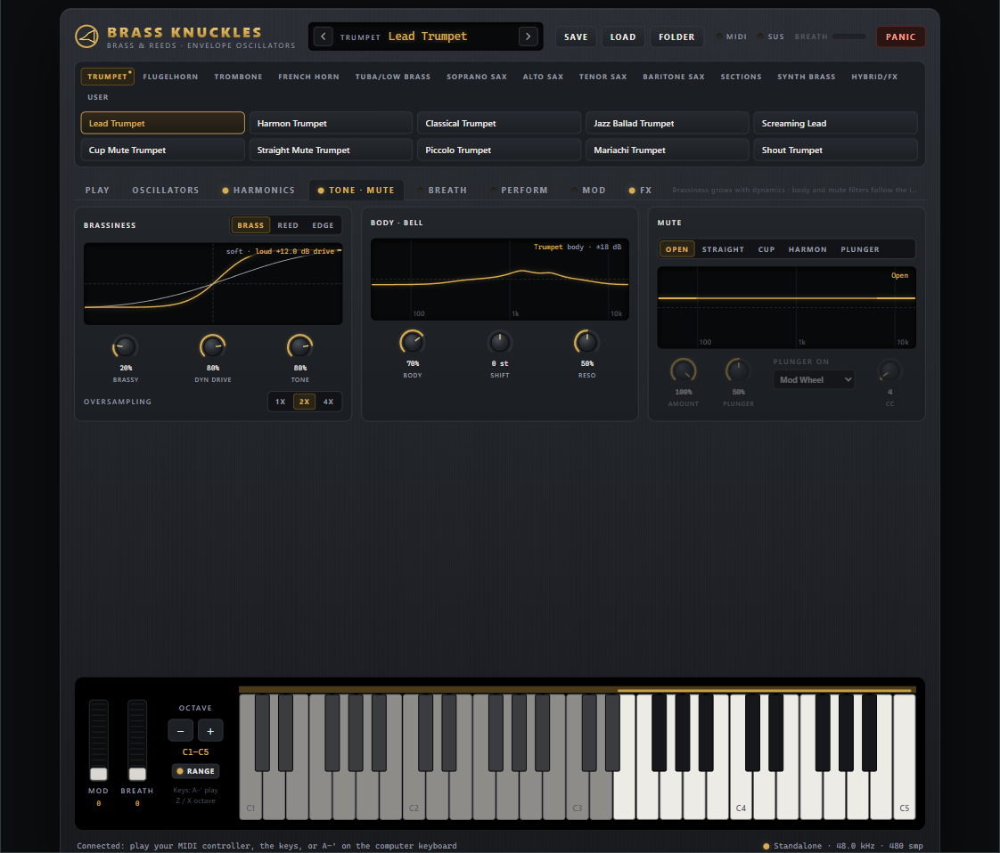
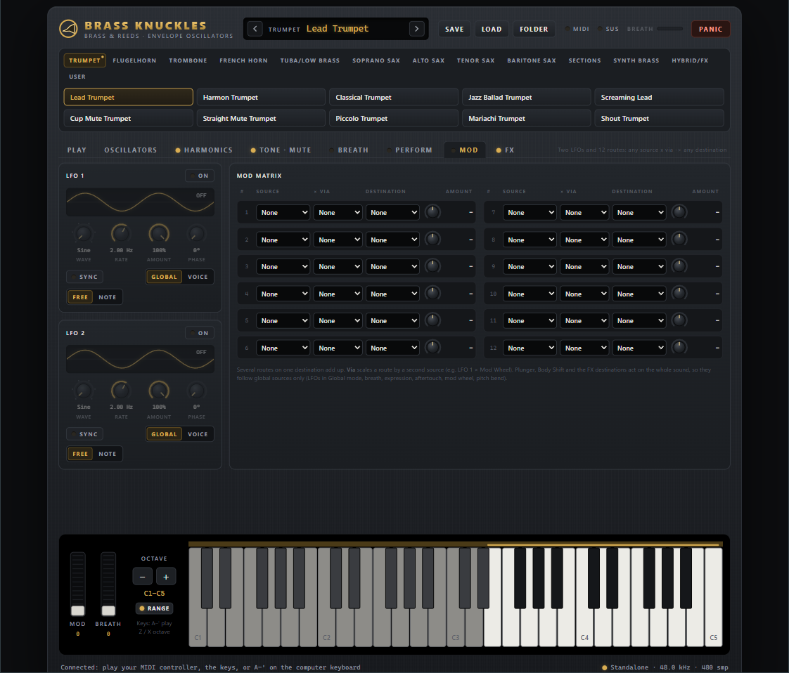

# Brass Knuckles — v1.0 (release candidate)

Brass Knuckles is a polyphonic brass and reed synthesizer: trumpet, flugelhorn, trombone, French horn, tuba,
soprano, alto, tenor and baritone sax, brass and sax sections, and classic synth brass. It is built to respond the way
a player does: louder notes get brighter and edgier, notes scoop and blip into pitch, the upper harmonics arrive a
moment after the fundamental, and a breath controller swells and brightens a held note.

| Build | Where | Status |
|---|---|---|
| **VST3 plugin** + Standalone | [`vst/`](vst/README.md) | v1.0 release candidate: complete engine, 120 presets, all automated checks passing |
| **Web build** | [`web/index.html`](web/index.html) | One self-contained HTML file: the same UI, a JS twin of the engine (checked against the C++ engine by a parity test), Web MIDI |



## What it does

### Envelope oscillators
- **3 oscillators** per voice, each morphing continuously Sine → Triangle → Saw → Pulse (with pulse width), with
  pitch, fine, level and its own key-tracked **brightness** filter (set in harmonics, so ×4 means "four harmonics" on
  every note).
- **Every oscillator has its own three envelopes**:
  - **Amp**: Delay, Attack, Hold, Decay, Sustain, Release, a curve per segment, velocity → level and attack time,
    key → times and level.
  - **Pitch**: the **scoop** into the note (start offset, time, curve) and a short **blip** on the attack.
  - **Timbre**: a DADSR that moves the oscillator's brightness and shape over the note.
- Draggable envelope graphs (Shift = fine, double-click a point = default).

### The harmonic layer (the brass signature)
- Up to **32 exact harmonics**, each with its own envelope. Low, mid and high band envelopes are blended across the
  harmonics, and **Spectral Delay** staggers them: the upper harmonics start later, swell in more slowly and fade first.
- The spectrum comes from an **instrument model** (one per instrument) and its slope follows the dynamics: steep and
  dark when soft, nearly flat when loud. Tilt and odd/even on top.



### Dynamics: louder is brighter
- One **dynamics** value per note from **velocity**, **breath** (CC2 or any CC), **expression** (CC11), **channel
  aftertouch** and **per-note pressure** (poly aftertouch / MPE), blended by weight.
- It drives **loudness**, **brightness** (on its own curve, so loud notes brighten faster than they get louder), the
  **brassiness** drive, and **attack speed** (soft notes swell in, hard notes bite).
- **Breath works over time**: hold a note and push the breath controller, and it swells and brightens. Until a breath
  controller sends anything, velocity alone sets the dynamics, so every preset plays properly from a keyboard.

### Tone: brassiness, body, mutes
- **Brassiness**: a waveshaper (Brass, Reed or Edge curve) whose drive grows with dynamics, **oversampled 1×, 2× or 4×**.
- **Attack and breath**: lip buzz / reed onset, breath noise shaped by the instrument and following the dynamics, sax
  key click and reed chiff, and **tongue** (soft, normal, hard).
- **Body / bell** resonances per instrument.
- **Mutes**: straight, cup, harmon and **plunger**, a wah you can play from the mod wheel, breath, expression,
  aftertouch, any CC, or a knob.
- **Growl** and **flutter tongue**.

### Playing
- **Articulations**: **fall, doit, rip, shake and scoop**, latched by **keyswitches** (C0-F0 by default) or the
  PERFORM page. Falls and doits happen as you release the note; rips climb in steps; shakes trill.
- **Auto articulations**: after a gap, soft notes scoop and hard notes rip; a hard note held to the end of a phrase falls.
- **Poly, Mono and Legato** with glide (time, curve, always or legato only) and a **lip-slur dip** between legato notes.
- **Vibrato**: delay, fade-in, rate, pitch and amplitude depth (lip vs. jaw), humanised drift, depth on the mod wheel.
- **Section mode**: 2-8 players per note with their own detune, timing, vibrato, timbre and stereo position.
- **Analog engine**: subtractive synth brass with unison (up to 7) and the attack "blat".
- **MPE**: per-note bend, pressure (dynamics) and slide (brightness).
- Pitch bend up to ±24, polyphony up to 64 notes (default 32), voice stealing with a short fade.
- Keys outside the instrument's real range are shaded on the keyboard (still playable).

### Modulation and FX
- **Two LFOs** (6 shapes, free or tempo-synced, global or per voice, free-running or note-triggered).
- **Mod matrix, 12 routes**: 28 sources (every envelope, LFOs, velocity, dynamics, breath, expression, aftertouch,
  MPE, mod wheel, bend, key, random, vibrato) × an optional Via source → 38 destinations.
- **FX**: drive (tube / tape, automatically level-matched), 3-band EQ, stereo chorus, plate / hall reverb, width.

| | |
|---|---|
|  |  |
|  |  |

## Build and install

Requirements: Windows, Visual Studio 2022 or 2026 with the C++ workload, Git, and the WebView2 runtime (built into
Windows 11). JUCE 8.0.17 downloads on the first build (or is reused from E-Piano's build folder).

```
vst\build.bat      build the VST3, the Standalone app and the test tool (Release)
vst\install.bat    copy "Brass Knuckles.vst3" to C:\Program Files\Common Files\VST3 (asks for admin)
```

Then rescan plugins in your host. The Standalone app
(`%LOCALAPPDATA%\BrassKnucklesVST\build\BrassKnucklesVST_artefacts\Release\Standalone\Brass Knuckles.exe`) plays
without a host; pick the audio device and MIDI input under *Options → Audio/MIDI Settings*.

In the host, Brass Knuckles is an instrument with MIDI in and stereo out. All 341 parameters can be automated; the 120
factory presets are also host programs. **Right-click any control** for the host's own parameter menu (automation,
link to controller).

## Web build

`web/index.html` is the whole instrument in one file (UI, engine, 120 presets; about 300 KB, no downloads). It runs in
**Chrome or Edge** (desktop).

```
start.bat                                   serve web/ at http://localhost:8080 and open it (recommended)
vst\webhost\build-web.ps1                   rebuild web/index.html after changing vst/ui, vst/webhost or the presets
```

- **Served** (`start.bat`) the engine runs in an **AudioWorklet**, on its own audio thread (about 10 ms of output
  latency). **Opened straight from disk** it still works, but browsers block AudioWorklets on `file://`, so the
  engine runs on the page's main thread through a ScriptProcessor: more latency, and heavy chords can crackle.
- Click anywhere once to start the audio (browsers require a click before sound).
- **MIDI**: Web MIDI, all inputs or one (the **MIDI IN** menu in the header). Everything the plugin understands
  works the same way: breath CC, expression, aftertouch, poly pressure, pitch bend, keyswitches, MPE.
- **Tempo** for synced LFOs is the **BPM** field in the header (the plugin takes it from the host).
- **Presets**: saved in the browser by default. Click **FOLDER** to link a folder on disk instead; link
  `Documents\Brass Knuckles\Presets` and the web build and the VST share the same `.bkpreset` files. A linked folder
  is rescanned every 2 seconds, like the plugin's. **LOAD** opens any `.bkpreset` file.
- **CPU** (one core): JavaScript is about 2.5-3× slower than the C++ build. A solo preset uses 2-3% for one note and
  about 14% for a 12-note chord; a section preset with a 4-note chord 12-22%. Section presets with 8 players and a
  12-note chord use about 63%, near the limit of a browser audio thread: play big section chords in the VST.

## MIDI, breath controllers, keyswitches, MPE

- **Breath controllers** (TEControl, Yamaha BC, Akai EWI in breath mode…) usually send **CC2**. If yours sends
  something else, set **Breath CC** on the PLAY page. The **BREATH** meter in the header lights up once it is detected.
  From then on, breath sets the dynamics and zero breath is silence, as on a real horn; **Vel + Ctl** sets how much
  velocity still colours it. Double-click the on-screen BREATH wheel, or send *Reset All Controllers* (CC121), to go
  back to velocity-only playing.
- **Expression pedal** (CC11) and **aftertouch** can join in: turn up **Expr** or **Aftert.** under Dynamics.
- **Keyswitches** (on by default): **C0** normal, **C#0** fall, **D0** doit, **D#0** rip, **E0** shake, **F0** scoop
  (C4 = middle C). They latch until the next keyswitch, never sound, and are coloured on the on-screen keyboard. Move
  them with **KS Base** on the PERFORM page, or switch them off if your lowest notes need that octave.
- **MPE**: switch **MPE** on (PERFORM page). Channel 1 is the master channel (bends everything by Bend Range); each
  member channel bends its own note by MPE Bend Range; per-note pressure feeds the dynamics; slide (CC74) moves the
  brightness, and is also a mod matrix source.
- **Mod wheel**: vibrato depth on most presets; the plunger on Plunger Bone; wah depth on Tempo Wah Horn.

## Presets

120 factory presets, 12 categories of 10, level-matched to within 0.1 dB. Each is set up to sound right from
velocity alone and better with a breath controller.

| Category | Presets |
|---|---|
| **Trumpet** | Lead Trumpet, Harmon Trumpet, Classical Trumpet, Jazz Ballad Trumpet, Screaming Lead, Cup Mute Trumpet, Straight Mute Trumpet, Piccolo Trumpet, Mariachi Trumpet, Shout Trumpet |
| **Flugelhorn** | Mellow Flugel, Ballad Flugel, Dark Flugel, Bright Flugel, Breathy Flugel, Flugel Pad, Whisper Flugel, Flugel Choir, Close Flugel, Flugel Legato Lead |
| **Trombone** | Tenor Trombone, Plunger Bone, Bass Trombone, Slide Trombone, Jazz Bone, Blatty Bone, Cup Mute Bone, Growl Bone, Bone Ensemble, Ballad Bone |
| **French Horn** | Concert Horn, Horn Solo, Horn Section, Stopped Horn, Epic Horns, Soft Horn Pad, Cuivre Horn, Wagner Horns, Horn Legato, Muted Horn |
| **Tuba/Low Brass** | Concert Tuba, Legato Tuba, Sousaphone, Euphonium, Low Brass Section, Tuba Staccato, Cimbasso, Contrabass Tuba, Growl Tuba, Tuba Pad |
| **Soprano Sax** | Soprano Sax, Smooth Soprano, Bright Soprano, Breathy Soprano, Soprano Section, Classical Soprano, Soprano Legato, Growl Soprano, Straight Soprano, Soprano Pad |
| **Alto Sax** | Alto Sax, Bebop Alto, Smooth Alto, Rock Alto, Ballad Alto, Alto Section, Funk Alto, Subtone Alto, Alto Legato, Growl Alto |
| **Tenor Sax** | Tenor Sax, Growl Tenor, Ballad Tenor, Subtone Tenor, R&B Tenor, Bebop Tenor, Tenor Section, Honking Tenor, Smoky Tenor, Tenor Legato |
| **Baritone Sax** | Bari Sax, Funk Bari, Smooth Bari, Growl Bari, Bari Section, Bari Honk, Subtone Bari, Bari Legato, Bari Ballad, Bari Pad |
| **Sections** | Trumpet Section, Trombone Section, Sax Section, Big Band Stab, Brass Pad, Full Brass Swell, Soft Sax Pad, Shout Section, Mellow Ensemble, Fanfare Section |
| **Synth Brass** | 80s Stab, 80s Brass Stack, Blat Brass, Poly Brass, Synth Brass Pad, Jump Brass, Synth Horn Hybrid, Funk Synth Brass, Wide Unison Brass, Pulse Brass |
| **Hybrid/FX** | Swell Horn, Tempo Wah Horn, Tremolo Flugel, Breath Pad, Shimmer Horns, Doppler Brass, Space Flugel, Growl Machine, S&H Brass, Underwater Horn |

User presets are `.bkpreset` files (plain JSON, versioned) in **`Documents\Brass Knuckles\Presets`**, one subfolder
per category. New, renamed and deleted files show up within about 2 seconds; SAVE asks before replacing a file; the ×
on a user preset moves it to the Recycle Bin.

## Checked automatically

`BrassKnucklesTests.exe` (details in [vst/README.md](vst/README.md#tests)) checks, among others:
- every preset loads, renders, isn't silent, doesn't clip, and is within ±1 dB of the loudness target (all 120: −18.05 to −17.95 dB)
- **brightness rises with dynamics** for every acoustic preset, and a breath swell makes a held note louder and brighter
- **legato glides don't click** (76 legato presets; the detector is proven on an injected −46 dBFS step)
- **aliasing** at C6, velocity 127: below −60 dB at the preset drive with 4× oversampling
- articulations, sections, MPE, the analog engine, LFOs, every matrix path, every FX, level matching of drive /
  chorus / reverb, reverb tails ending at exactly zero
- the built VST3 loads in a VST3 host, plays, automates, restores its state and switches programs
- the C++ and JS parameter tables match exactly
- **C++/JS parity**: 158 scenarios (every engine feature, and every factory preset) rendered by both engines agree
  to within 4·10⁻⁶ (RMS per window and peak)
- the web build in headless Edge: every control reaches the engine, presets load, save, reload and delete, preset
  files load (including old or broken ones), the keyboard, articulations and the BREATH wheel work, and served over
  http the AudioWorklet plays a note

CPU (one core, 48 kHz): a solo preset with 32 notes uses 15-20%; the section presets playing a 12-note chord 8-25%; the
synthetic worst case (32 notes × 8 players × 4× oversampling × every feature, FX and 12 routes) 88%.

## Status and known limitations

- **Still to confirm by hand** in a host (Minihost Modular): the sound of each preset, breath controllers, MPE
  controllers, the right-click automation menu.
- Windows only for now. The code is portable JUCE, but no macOS build has been set up.
- The PolyBLEP oscillators alias a little on very high, very loud notes (about −42 dB at C6); the presets take most of
  their brightness from the alias-free harmonic layer instead.
- The physical-model (lip-reed / single-reed waveguide) engine has its interface in place but no sound yet.
- The web build is tested in Edge (Chromium). Linking a preset folder needs Chrome or Edge; Safari has no Web MIDI.
  Other browsers are untested.
- Next: the physical model (phase 7).

## Repository layout

```
vst/                      VST3 plugin (JUCE 8): Source/, ui/, webhost/, presets/, tests/
docs/                     CONVENTIONS.md, PLAN.md, screenshots/
start.bat, serve.ps1      local server for the web build (serve.ps1 -Dev: unbundled, straight from the sources)
web/index.html            web build (generated by vst/webhost/build-web.ps1)
```
